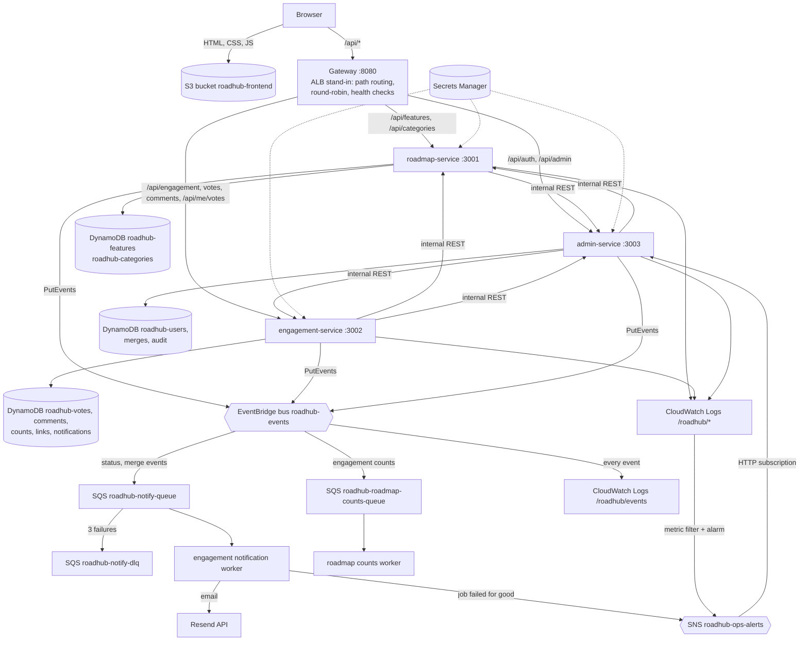

# Architecture

## Decisions that change the Phase 1 proposal
| Phase 1 proposal | Final design | Why |
|---|---|---|
| Five statuses incl. Declined; "Merged" shown as a status | **Four public statuses only** (Under Review, Planned, In Progress, Shipped). Merging is an internal record state (`mergeState`), never a board column | Updated project brief |
| One backend with three logical services, on Vercel | **Three independent Express backends** (own app, port, tables, IAM role, logs) behind one gateway | Individual ownership and real service-to-service communication |
| Neon Postgres + Vercel as the deployment | **Floci is the assessed deployment** (Lab 7/8 style). Vercel + Neon only as a supplementary public copy, done last if time allows | University announcement: Vercel/Neon without Floci is a minimum submission |
| Secrets in Vercel environment variables | **AWS Secrets Manager** (Floci) | Required AWS service, least privilege per service |
| Merge moves votes and comments | **Logical merge**: the duplicate points to the canonical request; votes and comments keep their original owner record and are counted/shown on the canonical request. Undo removes the link | No data is copied or lost; undo is exact; works across three databases without a distributed transaction |

## Overview

## Runtime on Floci (what is real and what is simulated)
| Piece | On Floci / this PC | Evidence label |
|---|---|---|
| S3 website, DynamoDB, EventBridge, SQS + DLQ, SNS, Secrets Manager, CloudWatch Logs, IAM | Real Floci resources used by the running code | PASS when the workflow is verified |
| Express backends | Node.js processes on ports 3001–3003 (more replicas on 3011+, 3021+, 3031+) | real |
| Gateway | Node.js reverse proxy on 8080 playing the ALB (Lab 8 does the same) | real routing, ALB is SIMULATED |
| ECS cluster, services, task definitions, ALB, target groups, Auto Scaling policies | Recorded in Floci by scripts, not running real containers | SIMULATED |
| IAM permissions | Stored in Floci, not enforced by default | documented |

## Why this design handles growth
- Backends are **stateless**: login state is a signed JWT, all data is in DynamoDB, so any replica can serve any request.
- The gateway spreads requests over replicas and skips a replica whose health check fails.
- DynamoDB uses **on-demand** capacity, **keys and indexes for every hot query** (no scans on normal requests), conditional writes and transactions for votes.
- Slow work (emails, count updates) leaves the request path through **EventBridge → SQS → workers**, with retries and a dead-letter queue.
- Rate limits, body-size limits, request timeouts and pagination protect each service.
- Load is measured with **k6** (1 replica vs 3 replicas, and a replica killed during traffic).
